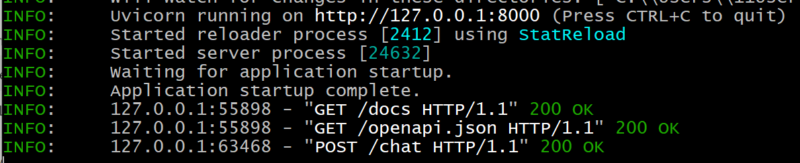
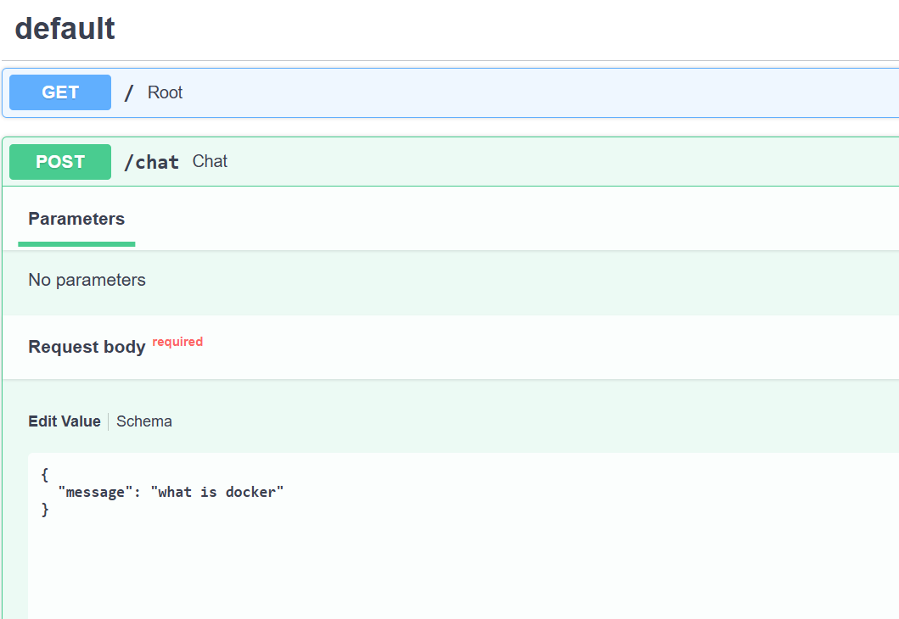

# Python DevOps AI project step by step, 
- From a simple AI application to a production, based on DevOps AI platform.

- We'll avoid jumping directly into Kubernetes, First we make the Python AI application work
  then containerize it, then add CI/CD, monitoring, Kubernetes, etc.

  
## STEP 1:   Python AI application
- Prerequisite -  Set python env if not work
  - Set it via Git Bash cli or via Cursor IDE
```
mkdir 01-chatbot
cd 01-chatbot/
python -m venv venv
python --version
python -ver
which python
which py
py --version

  # Make it permanent it git bash
export PATH="/c/Users/YuorUser/AppData/Local/Programs/Python/Python313:$PATH"
python -version
python --version
  # Add path to bashrc file
vi ~/.bashrc
source ~/.bashrc
python -m venv venv
```
## Install fastapi, uvicorn, python-dotenv modules of python, 
- Don't install everything yet. We'll build it incrementally, Later we'll add:
  - LangChain
  - OpenRouter
  - Tavily
  - Pydantic


```
python -m venv venv
python -m pip --version
python -m pip install fastapi uvicorn python-dotenv
python -m pip install uvicorn

```

### Create the FastAPI application
- See the main.py file
- Run the uvicorn module, you should get Uvicorn running on http....

```
uvicorn app.main:app --reload
```



- Go to browser and run
```
http://127.0.0.1:8000
```
- Run via Swagger UI
```
http://127.0.0.1:8000/docs
```
- On Swagger UI, click on try it out - > type any message -> execute
- You should see the message you type




#### Next - STEP 2  Go to -> AI Agent and Tools

