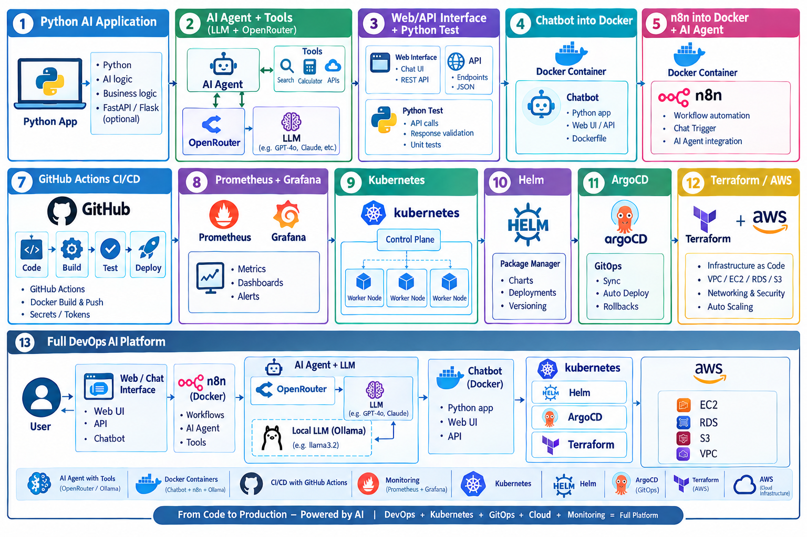

# Project Roadmap DevOps & DevOps AI

Welcome to the **DevOps Mentor–Mentee Project**  
This repository is designed to guide you step by step through building a **complete DevOps pipeline** — from coding an application, to deploying it with modern DevOps & DevOps AI practices.

# Architecture Diagram

---

## 📌 Project Prerequisites  

Before starting, please install the following tools (latest versions recommended):  

- [🐍 Python](https://www.python.org/downloads/) (or another language of your choice)  
- [🐳 Docker](https://www.docker.com/get-started/)  
 - [⚡ Git](https://git-scm.com/downloads)  
- [🔄 GitHub Actions](https://docs.github.com/en/actions)

## 📌 Project Prerequisites - Not now, Install it on Advance steps   
- [🚀 ArgoCD](https://argo-cd.readthedocs.io/en/stable/getting_started/)  
- [📦 Terraform](https://developer.hashicorp.com/terraform/downloads)  
- [📊 Grafana](https://grafana.com/get)  
- [📈 Prometheus](https://prometheus.io/download/)
- [🍃 MongoDB](https://www.mongodb.com/try/download/community)
- [☸️ Kubernetes](https://kubernetes.io/docs/tasks/tools/) 

---

## 📖 Table of Contents
Each step has its own folder 📂 with a detailed `README.md`.  
Click the **logos/emojis** below to jump directly to that step’s guide:  

| Step | Topic | Link |
|------|-------|------|
| 01 | 🍃 **Python AI application** | [📂 Step_01-chatbot based on Python AI application](./01-chatbot/README.md)) |
| 02 | 🤖 **AI Agent + Tools based on LLM (Large Language Model) and OpenRouter** | [📂 Step_02-AI-Agent Tools](./02-AI-AgentTools/README.md) |
| 03 | 🍃 **Web/API interface and python test** | [📂 Step_03-Web & API interface with python test](./03-WebAPI-interface/README.md) |
| 04 | 🐳 **Chatbot into Docker** | [📂 Step_04 - Add chatbot into Docker](./04-chatbot-into-docker/README.md) |
| 05 | ⚡ **n8n into Docker + integrated with AI Agent** | [📂 Step_05 - n8n node automation platform](./05-n8n-into-docker/README.md) |
| 06 | 🔒 **local-llm-ollama** | [📂 Step_06 - Ollama is local llm](./06-local-llm-ollama/README.md) |
| 07 | 🚀 **GitHub Actions CI/CD** | [📂 TBD](./TBD/README.md) |

## 🧩 Project Flow  

1. **Set up Git & version control** 🖥️  
2. **Develop an application** (Python example provided, but flexible) 📝  
3. **Add a database** (MongoDB) - Advantage 🍃  
4. **Containerize with Docker** 🐳  
   

## 📖 Table of Contents - - Not now, we will do it later on 

| Advance Step  | Topic | Link |
|------|-------|------|
| 08 | 📦 **Infrastructure as Code (IaC)** | [📂 TBD](./Step_08-Infrastructure_As_Code(IaC)/README.md) |
| 09 | 📊 **Monitoring & Logging** | [📂 TBD](./Step_09-Monitoring_And_Logging/README.md) |
| 10 | 🔐 **Security Implementation** | [📂 TBD](./Step_10-Security_Implementation/README.md) |
| 11 | 🏆 **Best Practices** | [📂 TBD](./Step_11-Best_Practice/README.md) |
---

## 🧩 Project Flow  

1. **Set up Git & version control** 🖥️  
2. **Develop an application** (Python example provided, but flexible) 📝  
3. **Add a database** (MongoDB) 🍃  
4. **Containerize with Docker** 🐳  
5. **Orchestrate with Kubernetes** ☸️  
6. **Automate testing (CI)** 🔄  
7. **Automate deployments with ArgoCD (CD)** 🚀  
8. **Manage infra with Terraform (IaC)** 📦  
9. **Add monitoring & logging (Grafana, Prometheus, ELK)** 📊  
10. **Secure the pipeline** 🔐  
11. **Follow best practices: code reviews, docs, automation** 🏆  

---

## 🖼️ Visuals  

### 🧭 TBD

---

## 🤝 Mentor–Mentee AI Collaboration  

This project is part of a **DevOps mentorship journey**.  
Feel free to use, fork, and extend! 💡  

---

## 📚 Resources  

- [DevOps Roadmap](https://roadmap.sh/devops)  
- [Kubernetes Official Docs](https://kubernetes.io/docs/)  
- [Docker Official Docs](https://docs.docker.com/)  
- [Terraform Tutorials](https://developer.hashicorp.com/terraform/tutorials)  
- [ArgoCD Docs](https://argo-cd.readthedocs.io/)  

---
